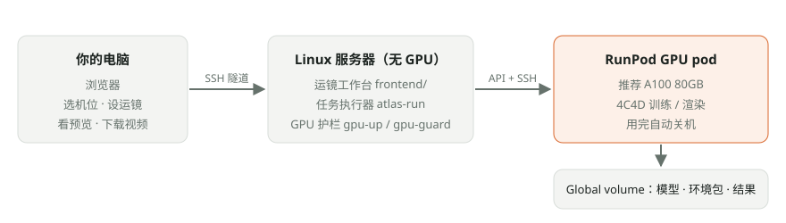

# photographer-videographer_killer

**From one camera that guesses to four cameras that measure — turning a research model into a camera-move workbench anyone can use.**

> ERA MOMENT internal validation project · USF BUS 205 course project

I first tested GEN3C, a video-diffusion model that renders new viewpoints from a single camera: for parts of the scene it never saw, it makes content up — including a ghost second person — and scored PSNR ≈ 16 against a real camera it had not seen. I then switched to 4C4D, a 4D reconstruction method that fits the scene to four calibrated cameras, which reached PSNR ≈ 22 on the same held-out view. Finally I wrapped the trained 4C4D model in a browser workbench: design a camera path, see the price, confirm, get a video.

## How it works

1. **Pick a scene** — choose a trained scene and one of its real cameras as the base camera.
   *[Screenshot placeholder: scene picker and base-camera thumbnails — `docs/img/step1-pick-scene.png`]*
2. **Set keyframes** — move, pan, tilt and zoom relative to the base camera, choose which second of the source video each keyframe shows, and play the camera path over a 3D point-cloud preview.
   *[Screenshot placeholder: keyframe editor and camera path in the 3D view — `docs/img/step2-keyframes.png`]*
3. **Confirm** — a dialog shows the GPU, frame count, estimated time and cost, and your balance; a GPU is started only after you confirm.
   *[Screenshot placeholder: confirm & render dialog — `docs/img/step3-confirm.png`]*
4. **Download** — follow progress and the actual GPU cost, then play or download the MP4. The 4-second sample took about 1.5 minutes and $0.045.
   *[Screenshot placeholder: finished render job with video — `docs/img/step4-download.png`]*

## Engineering challenges

The full write-up — diagrams, rejected alternatives, problems and fixes — is in **[docs/engineering.md](docs/engineering.md)**.

### 1. One coordinate system for cameras, model and keyframes
**Problem:** Panoptic footage is lens-distorted, its principal points are off-center by up to ~18 px, and its positions are in centimeters; 4C4D expects undistorted pinhole cameras in COLMAP format, and in centimeters a person 2.7 m away falls beyond the renderer's far plane (100 units). Any mismatch turns into a blurry or misplaced reconstruction.
**What I built:** A preparation pipeline that undistorts every frame, moves the principal point to the image center, converts to meters, writes a COLMAP model, and builds the initial point cloud by triangulating MASt3R matches with the known camera poses (held-out camera excluded); the workbench keeps the same OpenCV camera convention end to end and converts to three.js only for display.
**Evidence:** A 0–1.8 m vertical line drawn at the world origin lands on the person in all 5 cameras; synthetic triangulation with 0.3 px noise has < 1 mm median error; 33,153 points for the pose1 sequence. Counter-example: the GEN3C pipeline estimates the camera with ViPE instead — focal length 2807 vs. a true 1400 (2×), depth off by 1.55× — and scored PSNR 15.96.

### 2. From keyframes to a per-frame camera path
**Problem:** A person thinks "start here, end over there, turn a little"; the renderer needs an exact camera pose and source timestamp for every frame (up to 900), with no jerks at keyframes and the action staying in sync.
**What I built:** Keyframes are offsets from a real base camera, measured in camera spacings (median distance between neighboring real cameras) because reconstructed scenes have no reliable metric scale; positions follow a Catmull-Rom curve, rotations use quaternion slerp, every segment eases in and out (smoothstep), and the source-video time is interpolated with the same easing, clamped to the clip and mapped onto the model's time axis, with frame times covering the duration evenly so the last frame lands exactly on the last keyframe.
**Evidence:** 8 unit tests (camera spacing, zero offset = base camera, axis directions, pan and tilt signs, two-keyframe path, single static keyframe, source-time clamping); the 4-second sample path (cam00 → right 2 spacings, pan left 10°) rendered 120 frames on an A100 in 5.8 s.

### 3. Preview before you pay
**Problem:** Every real render starts a paid GPU, so discovering a bad camera path only after rendering wastes both money and minutes.
**What I built:** A one-time export turns the trained model into a browser preview — a 200,000-point cloud sampled from the model's 2.36 million Gaussians, the 21 real cameras and a thumbnail per camera — where the camera path is drawn in 3D and can be played through a "camera view" at the output aspect ratio; rendering needs an explicit confirmation that shows GPU, frames, estimated time and cost and the current balance, the server rejects render requests without it, and only one GPU job runs at a time.
**Evidence:** The export ran once for $0.04. The estimate is calibrated on measured runs (about 2 min fixed + frames ÷ 20.8 fps at 960×720): it quotes ~2.1 min / $0.06 for the 4-second clip versus 1.5 min / $0.045 actual. An unconfirmed render request returns `confirm_required` (checked in the headless-browser end-to-end test, 12/12 checks passing).

### 4. A 2-core server driving a cloud A100
**Problem:** The orchestration server has 2 cores and 4 GB RAM and must not run models; the GPU pod's disk is wiped on every stop, and installing the GEN3C, ViPE and 4C4D environments from scratch took about an hour.
**What I built:** A job runner in its own process (it survives web-server restarts) that starts a pod through the guard, rsyncs the pod scripts and job inputs, launches the task detached, polls status and frame progress every 15 s, pulls back only small results, and stops and deletes the pod by ID; environments are installed once, packed with conda-pack onto the RunPod Global volume, and unpacked on later boots.
**Evidence:** Restoring three environments took 2 min 23 s versus about 1 hour for the first install (the 4C4D environment alone: 39–59 s, measured 3 times). A 4-second render job — start pod, render, download, shut down — took about 1.5 min end to end, with 4.3 GB peak VRAM; runner tests 20/20.

### 5. Verifiable output
**Problem:** A generated video can look plausible and still be wrong; without ground truth you cannot tell a better model from a luckier demo, or a bug in my pipeline from a limit of the method.
**What I built:** Every Panoptic test holds out a real camera that no model sees; both models render exactly that viewpoint and are scored with PSNR / SSIM / LPIPS on the same frames, alongside "real | generated | difference ×3" videos, and 4C4D is evaluated once at the end of training rather than keeping the checkpoint that scored best on the held-out camera; to separate my pipeline from the dataset, I reran the paper's official N3V setup.
**Evidence:** Held-out camera (PSNR / SSIM / LPIPS): GEN3C 15.96 / 0.661 / 0.578 vs. 4C4D 21.74 / 0.818 / 0.378. N3V reproduction: PSNR 24.16 vs. 23.72 in the paper, DSSIM 0.0738 vs. 0.075, LPIPS 0.1137 vs. 0.114. Metric self-check: identical images 100 dB, an 8-pixel shift 24 dB.

## Safe to hand to a beginner

Every GPU start goes through the guard (`gpu-up`): A100 80GB only (H100 only when A100 is sold out), at most one pod at a time, at most 6 hours (30 minutes for workbench jobs). A watchdog runs every 10 minutes and stops pods that hit their time limit, sit below 5% GPU use for 30 minutes, or finished their job 5 minutes ago — syncing results first. It refuses to start a pod when the account balance is below $3 (RunPod deletes the storage volume 15 days after the balance hits zero) and only ever touches pods named `atlas-*`. The guard has 77 offline tests against a fake RunPod API; details in [guard/README.md](guard/README.md).

## Quick start

Want to run it yourself? See **[DEPLOY.md](DEPLOY.md)** — 6 steps:

1. Sign up for [RunPod](https://www.runpod.io/) and add credit; **recommended GPU: A100 80GB**;
2. Create a Global volume and API keys;
3. Clone the repo;
4. Run `./deploy.sh`;
5. Train the sample model (one-time, about 4 hours, about $8);
6. Open the camera-move workbench.

After that, each camera move you render takes about 1.5 minutes and $0.05.



## Business background

ERA MOMENT does event photography and videography. In the US, a videographer for an 8-hour event rarely quotes below **$1,500**.
This project tests whether we can put just 1 360 camera (Insta360 X3) + a few phones on tripods at an event,
then use AI to reconstruct the scene afterwards and generate video with camera motion — replacing or supplementing an on-site videographer at a **GPU cost well below $1,500**.

## Stages

| Stage | Scope | Status |
|---|---|---|
| 0 | Repo setup | ✅ |
| 1 | GPU cost guard (start / stop / monitor RunPod pods), see [guard/](guard/README.md) | ✅ |
| 2 | Pod environment scripts (GEN3C / ViPE / 4C4D), see [pod/](pod/README.md) | ✅ |
| 3 | CMU Panoptic data preparation, see [docs/stage3-data.md](docs/stage3-data.md) | ✅ |
| 4 | GEN3C vs 4C4D baseline comparison, **report: [docs/report-baseline.md](docs/report-baseline.md)** | ✅ First round done |
| 5 | Camera-move workbench (Flask): 3D preview → set camera path → GPU render, see [frontend/](frontend/README.md) | ✅ Sample-scene version (real GPU test passed); footage upload still to do |
| 6 | Integrate the 360-to-perspective tool | ⏳ |

Detailed progress, issues, time and spending: [PROGRESS.md](PROGRESS.md).

## Phase 1 results (2026-10-15)

On CMU Panoptic, we generated frames from a camera that was not used in training and compared them with the real footage:

| Approach | Input | PSNR ↑ | SSIM ↑ | LPIPS ↓ | GPU cost |
|---|---|---|---|---|---|
| GEN3C | 1 camera | 15.96 | 0.661 | 0.578 | about $0.61 per 5 s of output |
| **4C4D** | 4 cameras | **21.74** | **0.818** | **0.378** | about $4.71 per 10 s of footage |

We also reproduced 4C4D on the N3V data used in the paper (PSNR 24.16 vs. 23.72 in the paper), which shows our environment is fine. Results on Panoptic are mediocre mainly because the cameras are too spread out; see the [reproduction report](docs/reproduction-n3v.md).

Producing a 3–5 minute AI camera-move highlight reel costs about $22–141 in GPU time, far below a $1,500 videographer quote; covering an entire 8-hour event, however, would exceed $1,500. 4C4D's current code cannot be used commercially. Details in the [comparison report](docs/report-baseline.md).

## Architecture

- **Orchestration server** (2 cores, 4 GB): runs only the frontend and orchestration scripts and stores small files; no models run here.
- **RunPod GPU pod** (A100 80GB, H100 if needed): all 3D reconstruction, training and video generation.
- **RunPod Global volume** (not tied to a data center; path inside the pod is `$ATLAS_VOL`): cold data only — model weights, raw datasets, environment packs, final results.
- **Pod container disk** (`$ATLAS_LOCAL`, 200 GB, wiped on stop): conda environments, working directories, intermediate files, checkpoints.
- Details: [docs/storage-and-env.md](docs/storage-and-env.md).

## Repository layout

```
.
├── DEPLOY.md         Deployment guide (starting from signing up for RunPod)
├── deploy.sh         One-step deploy / self-check (./deploy.sh --check)
├── requirements.txt  Server-side Python dependencies (flask, numpy)
├── README.md         Project overview
├── PROGRESS.md       Per-stage progress, issues, time, spending
├── CLAUDE.md         Project brief / working conventions
├── frontend/         Camera-move workbench (Flask + three.js, listens on 127.0.0.1 only)
├── guard/            GPU guard: gpu-up / gpu-down / gpu-status / gpu-guard + offline tests
├── runner/           atlas-run: server → pod job runner
├── pod/              Pod side: environment setup (GEN3C / ViPE / 4C4D), job scripts, model list
└── docs/             Reports and design docs
```

## Third-party model and data licenses

This repository **does not contain** any third-party model weights, datasets, or copies of their code — only links and the scripts that call them. Read and comply with each license before use:

| Name | Link | License (the official page is authoritative) | Commercial use? |
|---|---|---|---|
| CMU Panoptic Studio Dataset | http://domedb.perception.cs.cmu.edu/ | Non-commercial research only; see the site's terms of use | No |
| GEN3C (code) | https://github.com/nv-tlabs/GEN3C | Apache-2.0 | Yes |
| GEN3C-Cosmos-7B / Cosmos-Tokenize1 (weights) | https://huggingface.co/nvidia/GEN3C-Cosmos-7B | [NVIDIA Open Model License](https://www.nvidia.com/en-us/agreements/enterprise-software/nvidia-open-model-license) | Yes, but disabling the safety guardrails terminates the license (see pod/README.md) |
| T5-11B (GEN3C's text encoder) | https://huggingface.co/google-t5/t5-11b | Apache-2.0 | Yes |
| ViPE | https://github.com/nv-tlabs/vipe | Apache-2.0 (Unik3D portion CC BY-NC-SA 4.0); auto-downloaded depth models each have their own licenses | Code yes, some models no |
| 4C4D (CVPR 2026) | https://github.com/yangzf-1023/4C4D | MIT, but bundles the Inria 3DGS rasterizer (non-commercial) | No |
| MASt3R | https://github.com/naver/mast3r | CC BY-NC-SA 4.0; checkpoints are additionally bound by their training-dataset licenses | No |

> Note: CMU Panoptic, MASt3R and others are non-commercial licenses. Phase 1 of this project is academic / technical validation only; commercial use would require a separate license review.

## Security rules

This is a public repo. Never commit any keys, tokens, weights, datasets, videos, point clouds, training outputs, logs, pod IDs or IPs; no single file over 10 MB.
