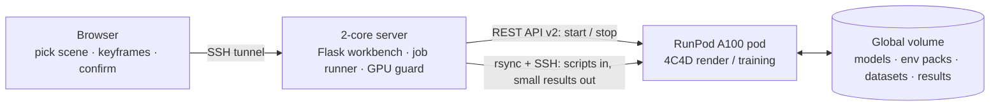
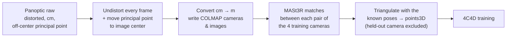
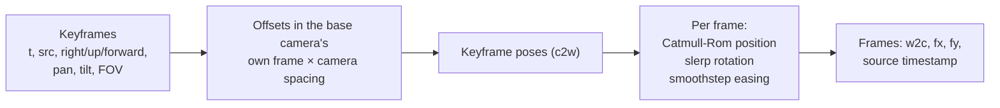
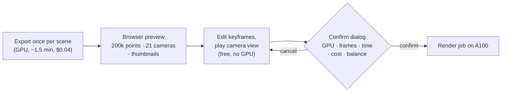
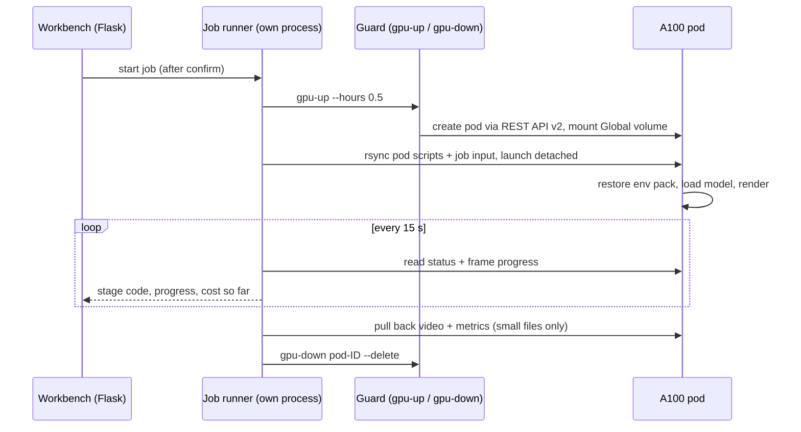
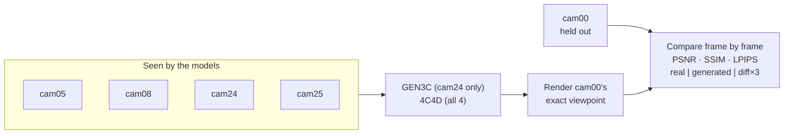

# Engineering notes

**From one camera that guesses to four cameras that measure — turning a research model into a camera-move workbench anyone can use.**

This document expands the five engineering challenges summarized in the [README](../README.md#engineering-challenges). Each section covers the design, the alternatives I rejected, the problems I hit and how I fixed them, and the evidence. Every number comes from a measured run or a test; the run-by-run log is in [PROGRESS.md](../PROGRESS.md).

The overall shape of the system:

---

## 1. One coordinate system for cameras, model and keyframes

### The problem

A reconstruction is only as good as the agreement between three things: where the cameras really were, how the model interprets them, and where the user asks the virtual camera to go. CMU Panoptic gives precise calibration, but in a form 4C4D cannot use directly:

- the images are lens-distorted, while 4C4D only supports undistorted pinhole cameras;
- the principal points are off-center by up to about 18 px, while 4C4D assumes a centered principal point;
- positions are in centimeters, and the 3DGS renderer's far clipping plane is 100 units — in centimeters, a person 2.7 m away would be clipped away.

### What I built

- `pod/tools/panoptic_prepare.py` downloads only the 10 s needed per camera (HTTP range requests), undistorts each frame, recenters the principal point, converts to meters and writes the COLMAP model.
- `pod/tools/mast3r_posed_points.py` runs MASt3R dense matching on every pair of the 4 training cameras and triangulates the matches with the **known** poses, keeping points whose reprojection error is under 8 px. The held-out evaluation camera is never used, so the score cannot "peek at the answer".
- The workbench keeps the same OpenCV convention (x right, y down, z forward) from `scene.json` through the trajectory math to the render job. The browser converts to three.js only for display: `c2w · diag(1, −1, −1, 1)`.

### Rejected alternatives

| Option | Why not |
|---|---|
| MAtCha's "posed" mode (the path in the official 4C4D pipeline) | Installed in editable mode with a hard-coded `/usr/local/cuda-11.8`, so it cannot be conda-packed (see section 4). Same idea — known poses + learned matches — so I reimplemented just the triangulation step. |
| Feeding ViPE the known intrinsics for the GEN3C input | ViPE's command line always runs its own calibration (GeoCalib) first. I kept the official default and recorded ViPE's error against the true calibration instead. |

### Problems and fixes

- **Too few points at first.** A 2-pixel reprojection threshold was too strict: MASt3R matches on 512-pixel-wide images, so one pixel there is 3.75 px at full resolution. Loosening it to 8 px only raised the count from 29,551 to 33,153 — the real limit was camera geometry. For adjacent camera pairs 26°–46° apart, 75–95% of matches pass the geometric check; for pairs 73°–145° apart, only 2–8% do. Practical rule for real shoots: **keep adjacent phones within about 45° of each other.**
- **Off-center principal point.** Found while checking fairness before the baseline run; fixed in the undistortion step and the data regenerated.

### Evidence

- A vertical line from 0 to 1.8 m drawn at the world origin and projected into all 5 cameras lands on the person standing there, feet to head — units, rotation/translation conventions and undistortion all agree.
- Synthetic test: points projected into two cameras with 0.3 px noise, then re-triangulated: median error under 1 mm.
- Point clouds: 33,153 points (`171204_pose1`), 18,638 points (`160906_band1`).
- **Counter-example — what happens without alignment.** GEN3C's pipeline estimates the camera from video with ViPE instead of using calibration. ViPE estimated a focal length of 2807 px against a true 1400 (2×) and a depth scale 1.55× too large; GEN3C scored PSNR 15.96 on the held-out camera, against 21.74 for the calibrated 4C4D pipeline.

---

## 2. From keyframes to a per-frame camera path

### The problem

A person thinks "start at this camera, end a bit to the right, turn slightly left". The renderer needs an exact camera pose, focal length and source timestamp for **every** frame (up to 900 per job), with no jerk at keyframes and the action staying in sync with the motion.

### What I built

`frontend/traj.py`:

- **Relative to a real camera.** Each keyframe is an offset from a chosen base camera, in that camera's own axes, so "right" always means right in the picture.
- **Units of camera spacing, not meters.** The spacing is the median distance from each real camera to its nearest neighbor. Reconstructed scenes do not have a reliable metric scale — in the N3V sample one spacing is 0.416 scene units — so "move 2 spacings" means the same thing in every scene and makes it obvious when the camera leaves the area the real cameras cover.
- **Interpolation.** Position follows a Catmull-Rom curve through the keyframes (smooth, passes through every keyframe); rotation uses quaternion slerp (no gimbal flips); each segment eases in and out with smoothstep. Field of view and source-video time are interpolated with the same easing parameter.
- **Time.** Source time is clamped to the clip and mapped onto the model's time axis. Frame times cover the duration evenly, so the last frame lands exactly on the last keyframe.

### Design choices

- Offsets in camera spacings instead of meters — see above; meters would be meaningless in scenes whose scale comes from MASt3R.
- The browser computes nothing itself: it asks the server for the same trajectory the GPU will render (`/api/path`), so the preview and the render cannot disagree.

### Problems and fixes

- The tilt sign was initially inverted — fixed and covered by a test.
- Early frame sampling did not land the last frame on the last keyframe — switched to evenly covering `[0, duration]`, covered by a test.
- In the 3D view, orbit controls kept the old "up" direction after switching to a base camera with a different orientation — the controls are now recreated on every base-camera change.

### Evidence

- 8 unit tests in `frontend/tests/test_traj.py`: zero offset equals the base camera, translation axes, pan right, tilt up, two-keyframe path, single static keyframe, source-time clamping, camera spacing.
- The 4-second sample path (cam00 → right 2 spacings, pan left 10°, 120 frames) rendered on an A100 in 5.8 s.

---

## 3. Preview before you pay

### The problem

Every real render starts a paid GPU. If the only way to check a camera path is to render it, every mistake costs a pod start and a couple of minutes.

### What I built

- **One-time export** (`pod/tools/fourc4d_direct.py export`): loads the trained 4C4D checkpoint directly — no training dataset needed — and writes a 200,000-point cloud sampled from the model's 2,355,367 Gaussians, the 21 real cameras, and a rendered thumbnail per camera.
- **Browser preview** (three.js): real cameras as grey frustums, keyframes in orange, the path as a line, and a "camera view" that plays the path at the output aspect ratio over the point cloud.
- **Explicit confirmation.** The dialog shows GPU, frame count, estimated time and cost, and the current balance. The server rejects any render request without `confirm: true` (`confirm_required`), caps a job at 900 frames and 1600×1200, and allows one GPU job at a time.
- **Estimate from measurements**, not guesses: about 2 min fixed cost (start pod, restore environment, load model, encode, download) plus frames ÷ 20.8 fps at 960×720, scaled by pixel count.

### Rejected alternative

Rendering real preview frames on the GPU while editing: every adjustment would mean a pod start (~1.5 min, a few cents) before you see anything. The point cloud is only a position guide, but it is free and instant.

### Problems and fixes

- The first estimate (4.5 min / $0.14 for a 4-second clip) was based on guesses and was three times too high; after the first real runs I recalibrated it on the measured timings.

### Evidence

- Scene export: about 1.5 min, $0.04, done once per scene.
- Estimate vs. actual for the 4-second sample: ~2.1 min / $0.06 quoted, 1.5 min / $0.045 actual (the estimate errs on the high side).
- The headless-browser end-to-end test (12/12 checks) walks through prepare scene → keyframes → confirm dialog → render job → video, and checks that an unconfirmed render request returns `confirm_required`.

---

## 4. A 2-core server driving a cloud A100

### The problem

The orchestration server is a shared 2-core, 4 GB machine that must not run models. The GPU pod's container disk is wiped every time it stops, and installing the GEN3C, ViPE and 4C4D environments from scratch took about an hour.

### What I built

- **Job runner** (`frontend/job_runner.py`) runs in its own process, so restarting the web server does not lose a job. It records the pod ID and stops and deletes the pod by ID when the job ends.
- **Task runner** (`runner/atlas_run.py`): pushes `pod/` with rsync, starts the task detached, follows its status, and pulls back only small files (large outputs stay on the Global volume).
- **Environment packs** (`pod/lib/common.sh`): each environment is installed once, packed with conda-pack into a single file on the Global volume (object storage reads one large file fastest), and unpacked onto the container disk on later boots. Packs are keyed by a pinned `ENV_REV` in each setup script.

### Rejected alternatives

From [storage-and-env.md](storage-and-env.md):

| Option | Why not |
|---|---|
| A. One Docker image per model | Half a day to a day of Dockerfile work; GitHub's free runners have no GPU and only about 14 GB of free disk; compiling flash-attn could approach the 6-hour job limit; each boot would still pull a 15–30 GB image. |
| B. Run the setup scripts on every boot | Estimated 40–125 minutes of GPU time per boot. Kept only as the automatic fallback when no pack exists. |
| **C. Install once, conda-pack, unpack on boot** | Chosen. |

### Problems and fixes

- **conda-pack rewrote script shebangs** to `#!/usr/bin/env python`, so ViPE's command picked up the system Python → its environment is put first on `PATH`.
- **setuptools from pip and conda got mixed** and broke after pack/restore → `SETUPTOOLS_USE_DISTUTILS=stdlib` as a workaround.
- **ViPE's `-v` started a viewer** that never exits on a headless pod (20 minutes wasted) → removed; the process is ended once the result file is written.
- **The SSH launch sometimes does not return** even though the task started → launched with `setsid` and a timeout; tracking continues by reading the status file.
- **A remote `pkill -f` matched the shell running it** → processes are killed by exact PID.
- **Two pods with the same name** (scene export, then render) made "stop by name" ambiguous, and the guard refused — the render pod kept running for about 30 extra seconds until I stopped it by ID → the job runner now stops and deletes by pod ID.
- **Session interruptions** once left a finished pod idling for about 35 minutes, and once stopped a pod before results were pulled back → the guard now stops a pod 5 minutes after its registered jobs finish, and fetches results before stopping.
- **Translating comments would have invalidated every pack** (keys were a hash of the setup script) → keys are now pinned with `ENV_REV`.

### Evidence

- Restoring three environments from packs: 2 min 23 s, versus about 1 hour for the first install. The 4C4D environment alone: 39–59 s (measured on 3 runs).
- A 4-second render job, from starting the pod to shutting it down: about 1.5 minutes, $0.045. The render itself: 120 frames in 5.8 s, 4.3 GB peak VRAM.
- Runner tests 20/20 (sync, pull-back size limit, failed tasks, pre_stop, env pack and restore).

---

## 5. Verifiable output

### The problem

A generated video can look plausible and still be wrong. Without ground truth you cannot tell a better model from a luckier demo — or a bug in my pipeline from a limit of the method.

### What I built

- **A held-out camera** in every Panoptic test: cam00 sits in the gap between two input cameras; no model sees its footage.
- **One metric script for both models** (`pod/tools/eval_metrics.py`): PSNR, SSIM and LPIPS on the same frames, plus "real | generated | difference ×3" videos.
- **Fairness fixes before the baseline run:** 4C4D's default keeps the checkpoint that scores best on the evaluation camera, which amounts to choosing the model after seeing the answers → I evaluate once at the end of training. 4C4D's yaml silently overrode command-line arguments → the iteration count is written into the yaml.
- **Reproduction on the paper's own data.** To find out whether 4C4D's middling Panoptic score was my pipeline or the dataset, I reran the official N3V `flame_steak` setup: the official yaml, training cameras 1, 10, 13, 20, half resolution as in the paper, all other cameras as test views (every 10th frame, 510 images), and the official code's default checkpoint selection, so the comparison with the paper is like-for-like.

### Problems and fixes

- The baseline run's 4C4D results were synced to the Global volume but not pulled back because the session was interrupted → added a `collect` task and fetch-before-stop in the guard.
- The N3V preprocessing package is only on Google Drive, and newer `gdown` dropped its `--id` option → download through Google Drive's direct confirm link.

### Evidence

| Test | PSNR ↑ | SSIM ↑ | LPIPS ↓ |
|---|---|---|---|
| GEN3C, 1 camera, held-out cam00 | 15.96 | 0.661 | 0.578 |
| 4C4D, 4 cameras, held-out cam00 | 21.74 | 0.818 | 0.378 |

| N3V `flame_steak` | PSNR ↑ | DSSIM₁ ↓ | DSSIM₂ ↓ | LPIPS ↓ |
|---|---|---|---|---|
| Ours | **24.16** | **0.0738** | **0.0451** | **0.1137** |
| Paper | 23.72 | 0.075 | 0.046 | 0.114 |

- Metric self-check: identical images score 100 dB, an 8-pixel shift 24 dB.
- Conclusion: the pipeline reproduces the paper, so the Panoptic gap comes from camera layout — Panoptic's 4 input cameras span 144° around the subject with a 72° gap, N3V's span 51° (see the [reproduction report](reproduction-n3v.md)).
